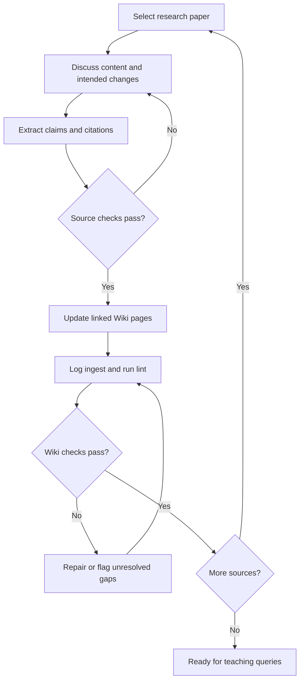
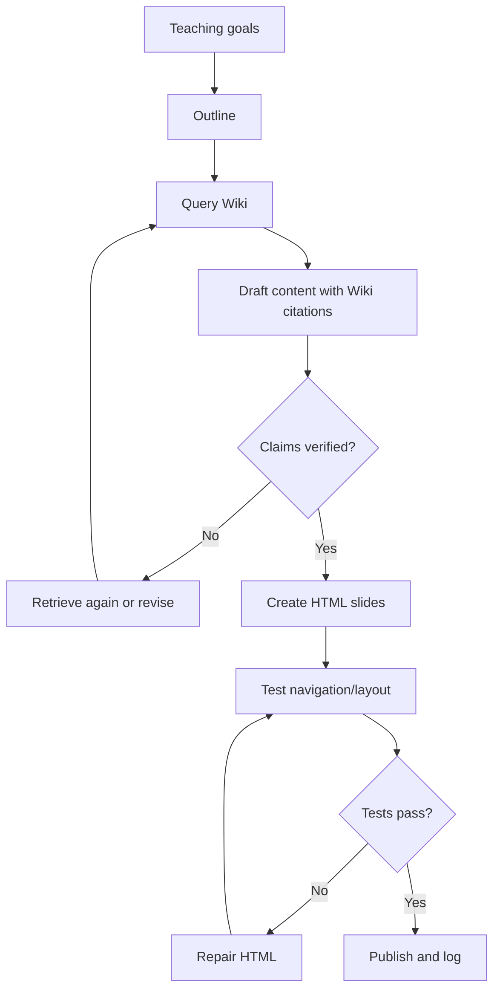

# Workflow graph and validation loops

## Graph A: Wiki construction

## Graph B: Wiki-to-slides

## Loop versus graph
Graph: nodes/edges define possible operations and conditions. Loop: a repeated path inside the graph to improve or correct a failed step. Maintain state containing source IDs, known claims, retry counters, diagnostics, and outputs. Max 2 retries per validation failure; unresolved issues require explicit human review.

## Evidence for reflection
Log actual failure frequency by node, which validation moved earlier, and before/after run results. Never invent a failure history to satisfy grading criteria.
